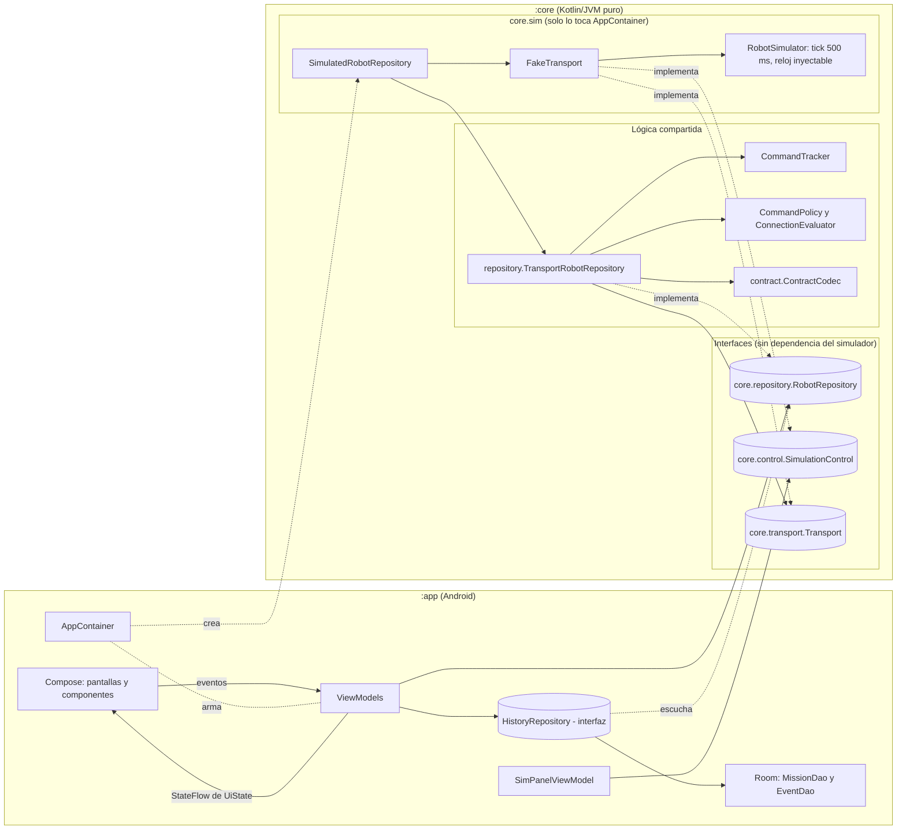

# Arquitectura

La app sigue MVVM sobre dos módulos Gradle: `:app` (Android) y `:core` (Kotlin/JVM puro). El flujo de datos va en una sola dirección: la UI observa `StateFlow` y envía eventos; el ViewModel conoce solo interfaces.

## Capas

- **UI (Compose).** Dibuja el estado y emite eventos. No importa nada de `ar.edu.uade.ronda.core.sim`.
- **ViewModel.** Transforma el estado del repositorio en `UiState` y recibe los eventos de la UI. Depende de las interfaces `RobotRepository` (`:core`, paquete `repository`) y `HistoryRepository` (`:app`). El `SimPanelViewModel` depende solo de `SimulationControl` (`:core`, paquete `control`).
- **Repository.** `RobotRepository` desacopla telemetría, comandos y eventos de la implementación. `TransportRobotRepository` implementa la interfaz sobre cualquier `Transport`: parsea el contrato con `ContractCodec`, deriva la conexión con `ConnectionEvaluator`, calcula la habilitación con `CommandPolicy` y sigue cada comando con `CommandTracker` (pendiente, confirmada, rechazada, sin respuesta, verificada). Un gateway real implicaría escribir otro `Transport`, sin tocar ViewModels.
- **Simulador (`core.sim`).** `RobotSimulator` produce y consume mensajes JSON del contrato (`docs/contrato/`); `FakeTransport` los transporta e implementa también `SimulationControl`. `SimulatedRobotRepository` arma todo y expone el `RobotRepository` y su `control`. El contrato documentado es el que usa el código.
- **Room.** Vive en `:app`. Guarda misiones y eventos; un `EventRecorder` escucha al `RobotRepository` y persiste.
- **`SimulationControl`.** Interfaz separada que solo usa el Panel de simulación (cortar el enlace, rechazar el próximo comando, demorar respuestas, inyectar incidentes, fijar la batería, cargar escenarios). La UI principal no la ve.

## Regla de dependencias

UI y ViewModels no importan el paquete `core.sim`. `AppContainer` (en `Application`) es el único lugar de `:app` que conoce la implementación simulada (`SimulatedRobotRepository`) y la inyecta como `RobotRepository` y `SimulationControl`.

El contrato JSON es una propuesta propia del grupo, no el protocolo oficial de Unitree.
