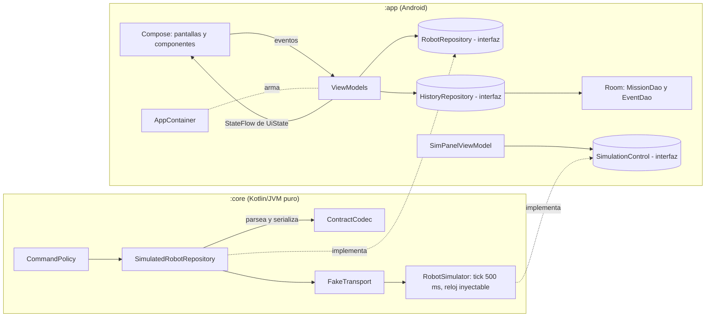

# Arquitectura

La app sigue MVVM sobre dos módulos Gradle: `:app` (Android) y `:core` (Kotlin/JVM puro). El flujo de datos va en una sola dirección: la UI observa `StateFlow` y envía eventos; el ViewModel conoce solo interfaces del repositorio.

## Capas

- **UI (Compose).** Dibuja el estado y emite eventos. No importa nada del simulador ni de `:core.sim`.
- **ViewModel.** Transforma el estado del repositorio en `UiState` y recibe los eventos de la UI. Solo depende de las interfaces `RobotRepository` y `HistoryRepository`.
- **Repository.** Desacopla telemetría, comandos y eventos de la implementación. `SimulatedRobotRepository` es la única implementación hoy; un gateway real implicaría otro `Transport`, sin tocar ViewModels.
- **Simulador.** `RobotSimulator` produce mensajes JSON del contrato (`docs/contrato/`) y los entrega por `FakeTransport`; el repositorio los parsea con `ContractCodec`. El contrato documentado es el que usa el código.
- **Room.** Vive en `:app`. Guarda misiones y eventos; un `EventRecorder` escucha al `RobotRepository` y persiste.
- **`SimulationControl`.** Interfaz separada que solo usa el Panel de simulación (forzar desconexión, rechazar el próximo comando, cargar escenarios). La UI principal no la ve.

## Regla de dependencias

UI y ViewModels no importan el paquete `sim`. `AppContainer` (en `Application`) es el único lugar de `:app` que conoce la implementación simulada y la inyecta como `RobotRepository`.

El contrato JSON es una propuesta propia del grupo, no el protocolo oficial de Unitree.
