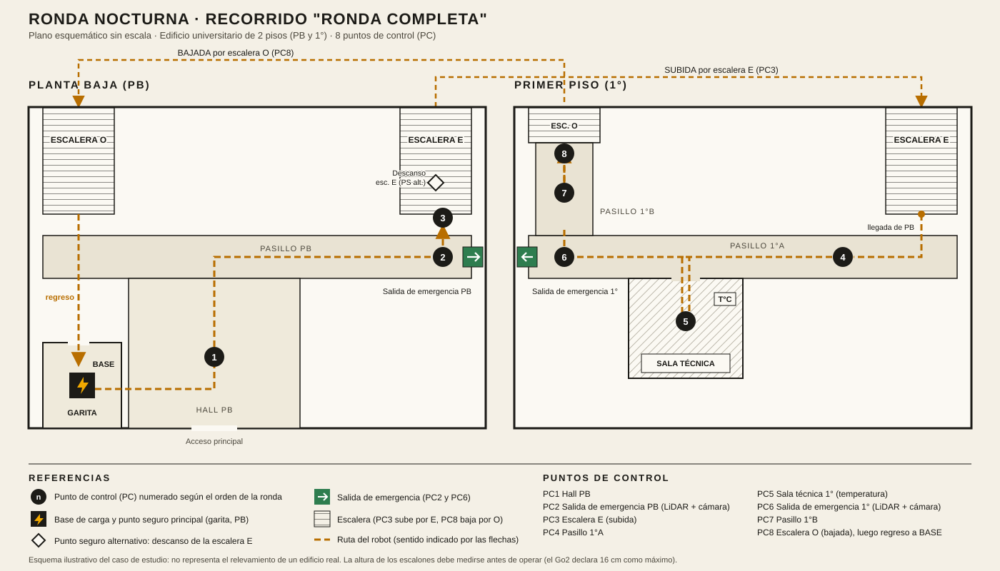
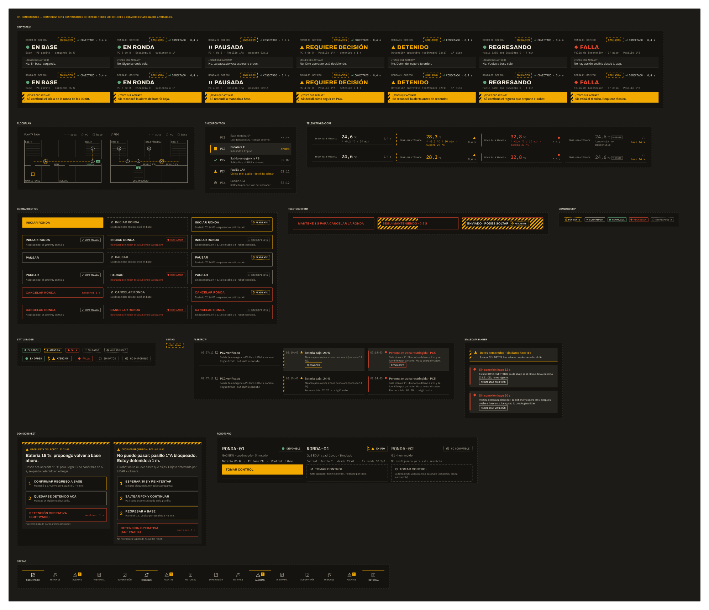
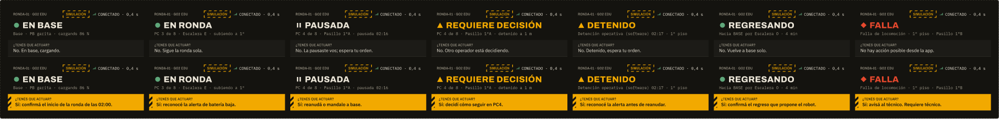

# RONDA: HMI de supervisión de un Unitree Go2 en rondas nocturnas

Informe final del TP grupal "Interfaz HMI/HRI para robots de servicio". Prototipo en Figma: <https://www.figma.com/design/sHIJRf9HU7ci8PdgY7hmIN> **[link final pendiente]** (ver §15).

Entregables: Figma, APK instalable y código fuente (este repositorio), diagrama de arquitectura, repositorio simulado y ejemplos de mensajes, evidencias de los cinco escenarios, registro de decisiones y limitaciones, y video de demostración. Lo que todavía no está terminado figura con el marcador **[PENDIENTE — Iñaki]** o **[link final pendiente]** y no se describen resultados que no existan.

Nota sobre el alcance: el edificio, los horarios y los umbrales son un caso de estudio armado por el grupo (referencia: una sede universitaria en CABA), no un relevamiento real. Los datos técnicos del robot salen de fuentes citadas en §18 y detalladas en `docs/fuentes.md`.

## 1. Problema

Entre las 23:00 y las 07:00 un edificio universitario de varios pisos queda con uno o dos vigilantes. La ronda a pie recorre pasillos, escaleras, salidas de emergencia, sala de servidores y tableros eléctricos, y se estima en 40 a 60 minutos (estimación del caso, a relevar con el personal de seguridad). Durante ese tiempo la garita queda sin cobertura.

Cómo se resuelve hoy:

- Ronda a pie del vigilante, registrada en una planilla de papel o con un lector de puntos de control (tags).
- Cámaras fijas en accesos y algunos pasillos.

Qué falla:

- La planilla y los tags prueban que el vigilante pasó, no qué encontró: no hay dato de temperatura de la sala técnica ni evidencia de qué salida estaba obstruida.
- Las rondas son repetitivas, se acortan con el cansancio y dejan una trazabilidad débil.
- Las cámaras fijas no verifican desde todos los ángulos que una salida de emergencia esté libre ni miden temperatura en un punto.

## 2. Entorno y recorrido

Edificio de dos pisos (planta baja y primer piso) con una garita de seguridad junto al acceso. El robot parte de una base de carga en la garita y recorre ocho puntos de control (PC):

`BASE → PC1 Hall PB → PC2 Salida de emergencia PB → PC3 Escalera E (subida) → PC4 Pasillo 1°A → PC5 Sala técnica 1° → PC6 Salida de emergencia 1° → PC7 Pasillo 1°B → PC8 Escalera O (bajada) → BASE`

Rutas adicionales para el selector de misiones: "Solo sala técnica" (PC1, PC3, PC5 y regreso) y "Salidas de emergencia" (PC2 y PC6). El punto seguro principal es la base; el alternativo es el descanso de la escalera E, para el caso en que la base quede lejos con batería baja.

La ronda usa dos escaleras. Eso condiciona la plataforma (ver §5) y plantea un riesgo concreto: el Go2 declara un escalón máximo de unos 16 cm (riesgo R7 en §13).

## 3. Actores, necesidades y situaciones de intervención

| Actor | Rol | Necesidad de información | Implicación de diseño |
|---|---|---|---|
| Vigilante de turno | Operador desde la garita (celular o tablet) | Saber en pocos segundos si tiene que actuar | Franja de estado fija con la pregunta "¿Tenés que actuar?"; decisiones guiadas con opciones |
| Jefe de seguridad o mantenimiento | Supervisor; revisa a la mañana | Trazabilidad y anomalías de la noche | Historial filtrable por tipo, severidad y fecha |
| Personal de limpieza nocturno | Tercero que comparte pasillos | Entender qué hace el robot y que no los va a chocar | HRI: velocidad reducida, mensaje de voz, aviso previo del horario de ronda |
| Estudiantes o docentes rezagados | Tercero ocasional antes de las 23:30 | No asustarse y saber a quién recurrir | Mensaje de voz identificatorio; no se registran rostros |
| Técnico | Mantenimiento del robot | Diagnóstico | Fuera del flujo principal; la falla se informa como "Requiere técnico" |

Situaciones en las que debe intervenir una persona (el robot se detiene y pide decisión, no resuelve solo):

1. Obstáculo que bloquea un pasillo.
2. Persona detectada en una zona restringida fuera de horario (sala técnica).
3. Salida de emergencia obstruida.
4. Batería que no alcanza para completar la ronda.
5. Pérdida de conexión o falla del robot.

## 4. Misión del robot

El robot recorre la ruta fija y, en cada punto de control, verifica con LiDAR y cámara que la salida de emergencia esté libre, lee la temperatura de la sala técnica con un sensor externo y registra anomalías. Ante lo no previsto se detiene y espera la decisión del operador. **No interviene físicamente**: no abre puertas, no mueve objetos, no enfrenta personas.

## 5. Elección de la plataforma

| Alternativa | Ventajas | Por qué no (o por qué sí) |
|---|---|---|
| Sin robot (vigilante a pie y cámaras fijas) | Más barata y flexible; sin riesgos propios de un robot | Deja la garita sin cobertura; no verifica salidas ni temperatura en cada punto; trazabilidad débil. Sigue siendo una opción válida si la frecuencia de rondas es baja; el robot se justifica por la repetición y los datos. |
| Robot con ruedas (AMR) | Más barato y estable en plano | No sube escaleras. |
| Unitree G1 (humanoide) | Manipulación, presencia humanoide | Pesa ~35 kg y mide 1,32 m; sale unos USD 13,5 mil frente a unos USD 11,2 mil de un Go2 EDU según distribuidores (la ficha oficial dice "consultar a ventas"); su ventaja (brazos y manos) no se usa en este caso; mayor riesgo en una caída en escalera; la velocidad de marcha no figura en las fuentes consultadas (G1-1, G1-2). |
| **Unitree Go2 EDU** | Cuadrúpedo, ~15 kg, 40 cm de alto; superficie baja; escalones de hasta ~16 cm; SDK completo solo en EDU; batería de 2 a 4 h | **Elegido.** Límites a considerar: escalón máximo, solo uso interior, evasión de obstáculos solo hacia adelante. |

Se elige la versión **EDU** porque el desarrollo secundario es completo solo en esa versión (en Air y Pro no hay y en X es parcial, GO2-1) y porque es la que lleva la batería de 15000 mAh. Lo que el robot hace de fábrica y lo que requeriría desarrollo o equipamiento adicional está en §6.

## 6. Capacidades: disponibles y adicionales

Contrastado con fuentes (GO2-1 a GO2-14, ver §18). Cuando las fuentes difieren se indica.

| Capacidad | Disponible en el Go2 EDU | Requiere equipamiento o desarrollo adicional |
|---|---|---|
| Locomoción en pasillos y escaleras | Sí: 12 motores articulares; escalón máx. ~16 cm; pendiente máx. 40°; hasta 3,7 m/s (GO2-1). El ángulo de escalera no figura en ninguna fuente. En la ronda simulada se supone 0,8 m/s | Relevar las escaleras del edificio: el manual no recomienda escaleras de más de 16 cm (GO2-8) |
| Percepción del entorno | LiDAR 4D L2 de 360 x 96°, distancia mínima 0,05 m; cámara HD frontal (GO2-1). Hay fichas que citan el L1; se adopta la oficial. | Mapa persistente del edificio y rutas por PC: desarrollo propio. La ficha oficial menciona mapeo 3D con LiDAR, pero las fuentes leídas no documentan navegación entre pisos |
| Evasión de obstáculos | Sí, **solo hacia adelante** (GO2-6, GO2-8). El SDK expone un interruptor del servicio (GO2-3) | Lógica de decisión ante obstáculos laterales o traseros: no cubierta |
| Autonomía y carga | 2 a 4 h con la batería de 15000 mAh (432 Wh según distribuidores, GO2-9 y GO2-10), medidas sin carga y alternando reposo y marcha; baja con velocidad, carga y terreno irregular (GO2-1, GO2-8). No hay medición independiente | Base de carga: el EDU es compatible con la "pila de carga" (GO2-1) y el manual dice que soporta carga autónoma (GO2-8); no se confirmó una llamada equivalente en el SDK. Los proyectos de patrullaje con Go2 resuelven el acople por fuera del firmware (GO2-12) |
| Comunicaciones | Wi-Fi 6 y 4G con GPS (GO2-1) | Gateway propio entre la app y el robot (DDS o ROS 2 hacia HTTPS o WebSocket) |
| SDK | `unitree_sdk2` (C++), `unitree_sdk2_python`, `unitree_ros2`, sobre DDS (GO2-2 a GO2-4). Desarrollo secundario completo solo en EDU (GO2-1) | Contenido del Document Center no legible con las herramientas usadas (ver `docs/fuentes.md`) |
| Cómputo | CPU de 8 núcleos; módulos externos tipo Orin como opción (GO2-1) | Solo si se agrega visión propia en el robot |
| Temperatura de la sala técnica | No | Sensor externo montado en el robot o fijo, con su integración |
| Detección de salida obstruida | Parcial: hay LiDAR y cámara | Clasificación propia sobre nube de puntos o imagen |
| Detección de persona | No es una función nativa en las fuentes leídas. El "seguimiento ISS 2.0" parece apoyarse en el control remoto, no en visión (interpretación del grupo) | Modelo de visión propio (un proyecto comunitario usa YOLO sobre la cámara frontal, GO2-12) y política de privacidad |
| Voz y parlante | Funciones de voz (GO2-1); parlante de 3 W según un distribuidor (GO2-6); control de volumen y luz en el SDK (GO2-3) | Mensajes propios de la ronda; potencia y modelo de parlante a confirmar |
| Condiciones de uso | 5 a 35 °C; sin protección contra agua ni polvo (GO2-7, GO2-8) | Uso solo interior |

## 7. Telemetría (frecuencia simulada: 2 Hz)

La antigüedad del dato se muestra siempre. El progreso se expresa por **puntos de control verificados**, no por porcentaje, porque el robot no puede conocer un porcentaje real de avance.

| Grupo | Campos | Cómo se muestra |
|---|---|---|
| Conectividad | `connection` (CONECTADO, DEGRADADO, SIN_DATOS, DESCONECTADO), `latencyMs` | Derivada de la antigüedad del último mensaje: más de 1,5 s degradado, más de 3 s sin datos, más de 10 s desconectado |
| Batería | `percent`, `minutesLeft`, `charging` | Porcentaje y "Alcanza para volver a base: Sí/No", calculado con la distancia restante |
| Estado operativo | EN_BASE, PREPARANDO, EN_RONDA, PAUSADA, REQUIERE_DECISION, DETENIDO, REGRESANDO, COMPLETADA, CANCELADA, FALLA | Texto, ícono y forma; nunca solo color |
| Misión y progreso | id, nombre, `checkpointIndex` de `checkpointsTotal`, etapa | "PC 4 de 8 · Pasillo 1°A" y lista de puntos con hora de verificación |
| Ubicación | piso, x, y, rumbo, zona | Plano del piso actual y texto "1° piso · Pasillo A" |
| Movimiento | velocidad en m/s, modo (CAMINANDO, DETENIDO, ESCALERA, GIRANDO) | Texto |
| Alertas | lista de alertas activas | Insignia con la cantidad sin reconocer |
| Última actualización | `timestamp` | "Actualizado hace 0,4 s"; al envejecer pasa a advertencia |
| **Servicio 1**: puntos verificados | `checkpointsVerified`, `checkpointsWithIssues` | "6/8 verificados · 1 con observación" |
| **Servicio 2**: temperatura de sala técnica | `techRoomTempC` y tendencia | Rótulo "sensor externo"; más de 27 °C advertencia, más de 32 °C alerta (umbrales propuestos por el grupo, a validar con el responsable de la sala) |
| **Servicio 3**: salidas de emergencia | estado por salida: LIBRE, OBSTRUIDA, NO_VERIFICADA | Lista por salida; es lo más relevante para seguridad |

El contrato de mensajes JSON es una **propuesta propia del grupo** para un gateway entre la app y el robot. **No es el protocolo oficial de Unitree**: el SDK real usa DDS (GO2-2 a GO2-4) y un gateway real traduciría estos mensajes a llamadas del SDK. Los ejemplos van en `docs/contrato/`.

## 8. Comandos

| Comando | Se habilita cuando | Si no, la app muestra |
|---|---|---|
| Iniciar misión | Robot en base, batería de al menos 40 % y suficiente para la ruta, conexión CONECTADO, sin falla ni comando pendiente | El motivo, por ejemplo "Batería insuficiente para la ronda completa (necesita 40 %)" |
| Pausar | Robot en ronda | "Solo se puede pausar durante la ronda" |
| Reanudar | Misión pausada o robot detenido, sin alerta crítica sin reconocer | "Reconocé la alerta antes de reanudar" |
| Cancelar misión | En ronda, pausada, esperando decisión o detenido | "No hay una misión en curso para cancelar" |
| Regresar a punto seguro | Cualquier estado fuera de la base, salvo falla | "El robot ya está en la base" o "Falla del robot: requiere técnico" |
| Detención operativa (software) | Robot en movimiento o esperando decisión; el botón es siempre visible | "El robot no está en movimiento" (el botón se mantiene visible, aclarando que no reemplaza la parada física) |
| Reconocer alerta | Hay una alerta activa sin reconocer | "No hay alertas pendientes de reconocer" |

Cada comando tiene un estado visible: **pendiente** (enviado, esperando), **confirmada** (el gateway lo aceptó), **rechazada** (con motivo legible) o **sin respuesta** (vence a los 4 s). Además, la telemetría puede marcar la **ejecución verificada** (por ejemplo, llega el estado PAUSADA después de "Pausar"). La app distingue enviada, aceptada y verificada.

Reglas de diseño:

- Un solo comando de misión pendiente a la vez. La detención operativa siempre puede enviarse.
- Con conexión SIN_DATOS o peor, todos los comandos se deshabilitan con motivo, salvo la detención operativa, que se envía igual y probablemente termine sin respuesta.
- Cancelar, regreso y detención usan **mantener presionado 1 s**; iniciar misión muestra un resumen previo de condiciones.
- Los comandos llevan un tiempo de vida (`ttlMs`): si llegan vencidos, el robot los descarta.

> **Detención operativa (software).** Es una orden simulada enviada al robot. **No reemplaza la parada de emergencia física.** Además, una orden enviada no equivale a una orden ejecutada.

Los coeficientes de consumo de batería del simulador se derivan de estos datos en `docs/supuestos-simulacion.md` (ver §11). Antecedentes de cuadrúpedos en patrullaje (Spot, ANYmal, Go2 en proyectos comunitarios y en Shanghai) están en `docs/fuentes.md`; no se halló un Go2 documentado en una ronda nocturna de edificio.

## 9. Arquitectura

Diagrama y descripción completa en [`docs/arquitectura/arquitectura.md`](../arquitectura/arquitectura.md). Resumen:

- Dos módulos Gradle: `:app` (Android: Compose, ViewModels, Room, `AppContainer`) y `:core` (Kotlin/JVM puro: dominio, contrato JSON, `Repository` y simulador). Separar `:core` permite compilar y probar la lógica sin Android SDK.
- Flujo en un solo sentido: la UI observa `StateFlow` de `UiState` y envía eventos al ViewModel; el ViewModel conoce solo las interfaces `RobotRepository` y `HistoryRepository`.
- `RobotRepository` desacopla telemetría, comandos y eventos de la implementación. `TransportRobotRepository` hace el trabajo sobre cualquier `Transport`: decodifica el contrato con `ContractCodec`, deriva la conexión (`ConnectionEvaluator`), calcula la habilitación de comandos (`CommandPolicy`) y sigue cada orden (`CommandTracker`).
- El simulador (`core.sim`: `RobotSimulator` con reloj inyectable, `FakeTransport`, `SimulatedRobotRepository`) produce y consume mensajes JSON del contrato. Solo `AppContainer` conoce esa implementación; ninguna clase de UI ni ViewModel importa el paquete `core.sim`. Un gateway real implicaría escribir otro `Transport`.
- Room guarda misiones y eventos (historial); un `EventRecorder` escucha al repositorio y persiste.
- El Panel de simulación usa una interfaz aparte, `SimulationControl` (cortar el enlace, rechazar la próxima orden, demorar respuestas, inyectar incidentes, fijar la batería, cargar escenarios), que la UI de supervisión no ve.

## 10. Contrato de mensajes

Los ejemplos JSON de telemetría, comandos, respuestas y eventos están en [`docs/contrato/`](../contrato/README.md) y son los que usa el código.

> **El contrato es una propuesta propia del grupo para un gateway entre la app y el robot. No es el protocolo oficial de Unitree.** El SDK real usa DDS (GO2-2 a GO2-4); un gateway real traduciría estos mensajes a llamadas del SDK.

Tipos de mensaje: telemetría (2 Hz), comando, respuesta (confirmada o rechazada con motivo) y evento (alerta, decisión requerida). Cada mensaje lleva `messageId` y `correlationId` como UUID v4; los comandos llevan `ttlMs`.

## 11. Simulador y modelo de batería

El simulador actualiza batería y telemetría, ejecuta misiones coherentes con sus estados, emite alertas y permite forzar desconexiones y rechazos desde el Panel de simulación.

El consumo de batería sigue un modelo de dos términos: un consumo base por segundo (robot encendido) más un consumo proporcional a la distancia. Los coeficientes son **supuestos del simulador, no mediciones del Go2**; se derivan de 432 Wh y de la autonomía declarada de 2 a 4 h en `docs/supuestos-simulacion.md`, que además justifica la reserva y el mínimo de 40 % para salir a la ronda completa. La ronda completa mide 293 m según el plano del simulador. Con coeficientes realistas una ronda completa gasta alrededor de 7 %, así que el escenario de batería baja simula una celda degradada (consumo multiplicado por 6) en lugar de forzar una carga inicial irreal (decisión D8 en `docs/decisiones.md`).

Supuesto de pérdida de enlace: el robot se detiene y a los 60 s regresa solo a la base; si el enlace vuelve antes, espera la orden del operador. Es un supuesto del caso, no una función verificada del Go2.

## 12. Escenarios y evidencias

| # | Escenario | Qué muestra |
|---|---|---|
| 1 | Ronda normal | Inicio, ocho PC, finalización y regreso; la misión queda en el historial |
| 2 | Batería baja | Sale con 40 % (mínimo operativo) y una celda degradada que multiplica el consumo; al cruzar 25 % (cerca del PC 4) aparece la advertencia con la acción "Regresar a base" y, a 15 % (PC 7), el robot propone el regreso (una sola opción). Llega a la base con ~2 %: el robot estima el regreso con consumo nominal, limitación registrada en D8 |
| 3 | Desconexión | Corte forzado de 15 s; datos marcados como antiguos, comandos sin confirmar y recuperación con resincronización |
| 4 | Incidente (obstáculo) | En PC4 un objeto bloquea el pasillo; el robot se detiene a 2 m y ofrece tres opciones (esperar 30 s, saltar PC4, regresar); el operador salta el punto y queda con observación |
| 5 | Persona en zona restringida (propio del servicio) | En PC5 el robot mantiene 2 m y se identifica por voz; el operador decide entre registrar como autorizada, enviar a un vigilante o continuar. No se guarda imagen |

Evidencias:

- Transcripciones de los cinco escenarios en [`docs/evidencias/transcripciones/`](../evidencias/transcripciones/): salida de `ScenarioTranscriptsTest`, que corre cada escenario contra el repositorio simulado con tiempo virtual y semilla fija. Demuestran el comportamiento del simulador y del contrato propio, no el de un robot real. Se regeneran con `./gradlew :core:scenarioTranscripts`; instrucciones en [`docs/evidencias/README.md`](../evidencias/README.md).
- Capturas de la pantalla de supervisión en [`docs/evidencias/capturas/`](../evidencias/capturas/) (ronda normal, obstáculo con decisión, sin datos, enlace restaurado, comando rechazado) y una grabación en [`docs/evidencias/video/supervision-demo.mp4`](../evidencias/video/supervision-demo.mp4).
- Capturas y evidencia de los cinco escenarios corridos sobre la app completa: **[PENDIENTE — Iñaki]**. Va una captura o secuencia por escenario tomada del APK, con su transcripción al lado.

## 13. Riesgos

Detalle completo (causa, consecuencia, medida y verificación) en [`docs/riesgos.md`](../riesgos.md). Severidad y probabilidad son estimaciones del grupo, no mediciones.

| # | Riesgo | Medida principal |
|---|---|---|
| R1 | Colisión o susto a una persona cercana | Velocidad reducida, parada a 2 m de una persona, aviso por voz, ronda después de las 23:30 |
| R2 | Orden accidental | Mantener presionado 1 s en las órdenes destructivas, estado PENDIENTE visible, un solo comando de misión pendiente |
| R3 | Pérdida de conexión | Datos marcados como antiguos, comandos deshabilitados con motivo, resincronización al volver; política del robot declarada como supuesto |
| R4 | Batería insuficiente para volver | Bloqueo de inicio, cálculo de "alcanza para volver", regreso propuesto a 15 % |
| R5 | Privacidad de personas detectadas | Sin imágenes, registro mínimo, retención de 30 días, historial solo para supervisor |
| R6 | Dos operadores con órdenes contradictorias | Sesión exclusiva por robot |
| R7 | Escalones fuera del rango del robot | Relevar escaleras antes de habilitar la ruta |

## 14. Decisiones y limitaciones

Registro completo en [`docs/decisiones.md`](../decisiones.md). Decisiones principales: `:core` JVM puro (D1), simulador que habla JSON (D2), inyección manual con `AppContainer` en lugar de Hilt (D3), Room para el historial (D4), progreso por puntos de control y no por porcentaje (D5), mantener presionado para los comandos críticos (D6) y `messageId` como UUID v4 (D7).

Limitaciones que importan para evaluar el trabajo:

- No se probó con un Go2 real: el contrato, el consumo y la política de pérdida de enlace son propuestas y supuestos del grupo.
- Escalones de más de 16 cm (R7): no se puede simular; se resuelve con el relevamiento del edificio.
- La detección de personas y de salidas obstruidas, y el sensor de temperatura de la sala técnica, no son capacidades nativas del Go2: en el simulador son datos generados.
- El acople autónomo a la base se simula; la llamada equivalente en el SDK no se pudo confirmar.
- Los umbrales de temperatura (27 y 32 °C), la retención de 30 días y el mínimo de 40 % de batería son propuestas del grupo.
- El Document Center de Unitree no se pudo leer; lo que se afirma del SDK sale de los README de GitHub.

## 15. Prototipo en Figma

Archivo actual: <https://www.figma.com/design/sHIJRf9HU7ci8PdgY7hmIN>. **[link final pendiente]**: el prototipo definitivo se está terminando en otra cuenta y este link se reemplaza cuando esté publicado.

Hecho al 2026-11-19 en el archivo actual (página `01 Sistema`, detalle en `design/FIGMA.md`): variables de color (tema noche y una muestra del tema día), espaciado y radios; estilos de texto (Archivo, IBM Plex Mono e IBM Plex Sans); símbolos de estado con redundancia (círculo lleno, triángulo con franjas, rombo, círculo punteado, contorno tachado); íconos lineales; y 14 componentes reutilizables con variantes de estado (normal, deshabilitado, advertencia, error), ligados a las variables. La dirección visual parte del plano de evacuación y de la planilla de ronda en papel: líneas finas, filas con reglas, estado siempre con color, forma y texto.

Pendiente de confirmar en el Figma final: portada y mapa de navegación, selección de robot, supervisión, telemetría, misiones, control, alertas con decisión requerida, historial, desconexión y panel de simulación, con el flujo normal (escenario 1) y el flujo con falla (escenarios 3 o 4) navegables. **[link final pendiente]**

## 16. Aplicación Android

El requisito es que el APK funcione sin robot, servidor ni internet. Lo que sigue depende de las fases F6 a F9 y no está redactado todavía; no se afirma ningún resultado de compilación o de tests de `:app` hasta que Iñaki los ejecute.

- **Pantallas restantes de la app** (selección de robot, misiones, control, alertas, historial, desconexión): **[PENDIENTE — Iñaki]**. Va una captura por pantalla y su relación con el Figma.
- **Panel de simulación** (cortar enlace, forzar rechazo, demorar respuestas, inyectar incidentes, cargar escenarios): **[PENDIENTE — Iñaki]**. Va la descripción de los controles y cómo se usan en la demo.
- **APK instalable** (ruta del archivo, versión, cómo instalarlo): **[PENDIENTE — Iñaki]**.
- **Tests de UI y resultado de la suite completa** (`:app:testDebugUnitTest`, pruebas manuales en emulador): **[PENDIENTE — Iñaki]**. Va la lista de tests y su resultado real.

## 17. Video de demostración

**[PENDIENTE — Iñaki]** Video final con los cinco escenarios sobre la app instalada: enlace o ruta, duración y guion por escenario. Hoy existe solo la grabación parcial mencionada en §12.

## 18. Fuentes

Consultadas el 2026-11-19. Detalle, datos extraídos y discrepancias entre fuentes en [`docs/fuentes.md`](../fuentes.md).

**Go2**

- GO2-1. Unitree, Go2: <https://www.unitree.com/go2>
- GO2-2. `unitree_sdk2`: <https://github.com/unitreerobotics/unitree_sdk2>
- GO2-3. `unitree_sdk2_python`: <https://github.com/unitreerobotics/unitree_sdk2_python>
- GO2-4. `unitree_ros2`: <https://github.com/unitreerobotics/unitree_ros2>
- GO2-5. Unitree Document Center (developer): <https://support.unitree.com/home/en/developer>. Referenciado desde los README; no se pudo leer su contenido.
- GO2-6. Robostore, Go2 EDU: <https://robostore.com/products/go2-edu-40-tops-computing-quadruped-robot-dog>
- GO2-7. GlobalDroneHQ, Go2 EDU: <https://globaldronehq.com/products/unitree-go2-edu-quadruped-robot>
- GO2-8. Manual de usuario del Go2 (ManualsLib): <https://www.manualslib.com/manual/3774520/Unitree-Go2.html>
- GO2-9 a GO2-14. Baterías (OpenElab, Robostore), datasheet EDU+ de QuakeLogic, proyecto comunitario de patrullaje, nota de Shanghai Daily y guía de GlobalDroneHQ: URLs en `docs/fuentes.md`.

**G1**

- G1-1. Unitree, G1: <https://www.unitree.com/g1>
- G1-2. RobotShop, G1: <https://www.robotshop.com/products/unitree-g1-humanoid-robot-us>

**Antecedentes y reserva de batería**

- SPOT-1. Boston Dynamics, Spot: <https://bostondynamics.com/products/spot/>
- ANY-1. ANYbotics, ANYmal: <https://www.anybotics.com/anymal>
- AMR-1. Open-RMF, configuración de ejemplo con `recharge_threshold: 0.10`: URL en `docs/fuentes.md`.

Discrepancias relevantes entre fuentes: cámara de profundidad (oficial: "solo EDU"; distribuidores: accesorio o solo versiones Plus), velocidad y carga máxima en la ficha de un distribuidor (inconsistente consigo misma, se descartó), modelo de LiDAR (L2 oficial frente a L1 en fichas antiguas), y capacidad de la batería de la EDU (8000 o 15000 mAh según el distribuidor; se adopta 15000 mAh). Los precios son de lista en dólares, sin impuestos ni flete.
